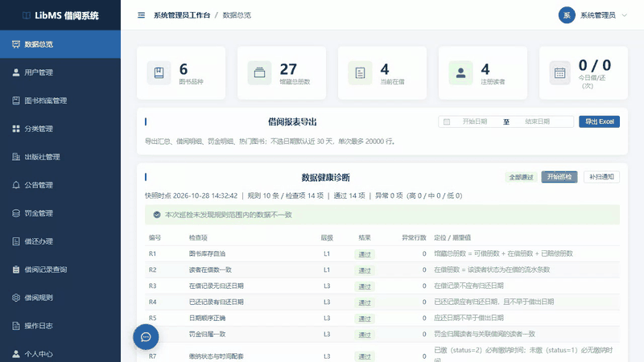

# LibMS 图书借阅管理系统

> Spring Boot 3 + Vue 3 的 B/S 图书借阅管理系统，面向中小型图书馆，设 **系统管理员 / 图书管理员 / 读者** 三类角色。

[](https://github.com/ruisen123/library-management-system/actions/workflows/ci.yml)

覆盖图书档案、读者账号、借还办理、预约排队、逾期罚金、数据统计与运行时数据一致性巡检，形成从档案管理到借还闭环的完整链路。



> 完整演示（含登录，34 秒）：[docs/demo/demo.webm](docs/demo/demo.webm)

## 和其他图书管理系统比，多了什么

| 能力 | 做了什么 | 去哪儿核对 |
|---|---|---|
| **运行时数据一致性巡检** | 10 条规则 / 14 项检查，在同一个只读事务内比对库存、在借数、预约与业务记录，输出实际值、期望值与定位，只检测不自动改数据 | 上面演示的第二屏；`backend/src/main/java/com/library/audit/` |
| **自动化回归 585 项** | 19 个套件覆盖接口、边界、安全、并发、巡检、E2E 与浏览器端，每轮落盘报告 | `test/`；`test/artifacts/` 132 份历史报告 |
| **生成列唯一索引** | 用 STORED 生成列解决「逻辑删除后唯一约束仍然撞车」的问题，4 张表落地 | `docs/04_数据库设计.sql`（搜 `uk_isbn`） |
| **密码指纹令牌失效** | 令牌里带密码摘要，改密后旧令牌立即失效，无需服务端会话表 | `AuthServiceImpl`、`JwtUtils`、`AuthInterceptor` |

## 功能特性

| 模块 | 主要内容 |
|---|---|
| 图书档案 | 分类 / 出版社 / 图书维护，封面上传，Excel 批量导入（模板下载 + 逐行错误明细），热门借阅排行 |
| 读者与账号 | 三角色权限，自助注册（按 IP 与全站双窗口限流），借阅额度（可借数 / 欠费阈值 / 证件有效期），冻结与重置密码 |
| 借还办理 | 借书、还书、续借；并发场景防超借（条件更新同时约束库存与读者额度），逾期罚金与赔偿 |
| 预约排队 | 无可借副本时排队，到书通知，待取 7 天由定时任务回收，库存变动自动顺延队列 |
| 站内通知与邮件 | 到书 / 到期 / 逾期 / 欠费 / 证件将到期提醒；通知表兼作邮件 outbox（认领式发送 + 指数退避重试） |
| 数据统计 | 借阅趋势、分类分布、热门排行，多 sheet Excel 报表导出 |
| 权限与审计 | 令牌拦截 + 角色注解（未标注默认拒绝），写操作日志与业务同事务 |

## 技术栈

| 层 | 选型 |
|---|---|
| 后端 | Java 21 · Spring Boot 3.2.5 · MyBatis-Plus 3.5.5 · JWT(jjwt 0.12.5) · EasyExcel · Maven |
| 前端 | Vue 3.5 · Element Plus · Pinia · Vue Router 4 · ECharts · Vite 5 |
| 数据库 | MySQL 8.0（10 张表 / 19 个 CHECK 约束） |
| 部署 | Docker Compose（MySQL + 后端 + Nginx 前端，一条命令拉起） |

规模：15 个控制器 / 59 个接口 / 17 个前端页面。

## 快速开始

### 方式一：Docker 一键部署（最快）

```bash
cd deploy/docker
cp .env.example .env      # 填入 MYSQL_ROOT_PASSWORD / MYSQL_PASSWORD / JWT_SECRET
docker compose up -d --build
```

浏览器访问 http://localhost:8088 ，用演示账号 `admin / 123456` 登录。

> `JWT_SECRET` 至少 32 字节，留空时 compose 会直接报错退出（避免用公开占位值启动）。
> 端口由 `WEB_PORT` 控制；Windows 上若 8088 落在系统保留端口段导致绑不上，改成 9088 等未占用端口即可。

### 方式二：本地运行

前置：JDK 21、Maven、Node.js 18+、MySQL 8.0。

**1) 导入数据库**（建库 + 10 张表 + 演示数据，脚本可重复执行）

```bash
mysql -u root -p --default-character-set=utf8mb4 < docs/04_数据库设计.sql
```

`--default-character-set=utf8mb4` 不能省，否则导入中文会报 `ERROR 1406: Data too long`。

**2) 启动后端**（端口 8080）

```bash
cd backend
mvn clean package -DskipTests
# Windows 用 set，macOS / Linux 用 export
set DB_USERNAME=root
set DB_PASSWORD=你的MySQL密码
set JWT_SECRET=一串至少32字节的随机字符
java -jar target/libms-backend-1.0.0.jar
```

**3) 启动前端**（端口 5173）

```bash
cd frontend
npm install
npm run dev
```

浏览器访问 http://localhost:5173 。

> 数据库口令与 JWT 密钥**只能**通过环境变量注入：`application.yml` 不提供默认值，缺失时后端启动即失败。这是刻意的 fail-fast，用来避免生产环境误用默认口令。

### 方式三：Windows 一键启动

双击根目录的 `一键启动.bat`，脚本会设置本地演示口令并依次拉起后端与前端。

## 容器镜像

推送 `backend/` 或 `frontend/` 改动时，Actions 会自动构建并推送到 GitHub Container Registry（已公开，无需登录即可拉取）：

- `ghcr.io/ruisen123/library-management-system-backend:latest`
- `ghcr.io/ruisen123/library-management-system-frontend:latest`

```bash
docker pull ghcr.io/ruisen123/library-management-system-backend:latest
docker pull ghcr.io/ruisen123/library-management-system-frontend:latest
```

> 镜像按 `linux/amd64` 构建；ARM 设备（Apple Silicon、ARM 服务器）拉取时加 `--platform linux/amd64`。
>
> 这两个镜像**不能单独运行**——后端需要 MySQL，前端需要后端。要跑起完整系统仍用 `deploy/docker/docker-compose.yml`（MySQL + 后端 + Nginx 前端三个容器）；单拉镜像只适合排障或二次开发。

## 目录结构

```
backend/    Spring Boot 后端（Java 21，Maven，controller/service/mapper/audit）
frontend/   Vue 3 前端（Vite，views 下 17 个页面）
docs/       数据库脚本、设计与联调文档、从零运行手册、界面截图、演示素材（demo/）
test/       自动化回归（Python 黑盒套件 + Playwright 浏览器套件）与 CI 结构断言
deploy/     部署脚本、SQL 迁移与 Docker Compose
.github/    CI 工作流
```

## 测试

分两层，职责不重叠：

| 层 | 覆盖内容 | 入口 |
|---|---|---|
| **自动化回归** | 19 个套件 / 585 项断言：接口、边界、安全、并发、巡检、E2E 与浏览器端 | `python test/run_all.py --browser` |
| **Java 单元测试** | 32 项：LIKE 通配符转义、JWT 生成/篡改/过期/启动自检、巡检规则契约、统一响应封装、注册限流窗口 | `cd backend && mvn test` |

> 分开的理由：Python 黑盒验证「系统在真实请求下的行为」，Java 单测验证「纯逻辑不依赖环境也成立」。单测不起 Spring 容器、不连数据库，14 秒跑完，因此能在 CI 里每次都跑。

```bash
python test/run_all.py --browser
```

判定标准是退出码为 0、通过数可解析且与注册的期望数一致；每轮报告写入 `test/artifacts/`。

> 测试会重建 `library_db`（清空后重新导入种子），不是隔离临时库。跑之前请备份非种子数据。

**CI 覆盖范围**（`.github/workflows/ci.yml`，每次 push 触发）：

- `构建与结构断言`：后端编译打包、前端构建，以及 `test/ci_structure_check.py`——把本文档里的 15 / 59 / 17 / 10 四个数字与代码绑定，任一处对不上就失败
- `全量回归（585 项）`：ubuntu runner 上起 MySQL 8.0 service、构建并启动后端 jar、起 vite dev server、安装 Playwright，跑 `test/run_all.py --browser`

CI 实测结果：**19/19 套件、585 项断言、0 失败**（专项 53 项另计）。本机历史报告见 `test/artifacts/`。

## 实测性能

数据来自 `test/perf/bench_api.py`，原始报告见 `test/artifacts/bench_api_20261024_2310.md`（2026-10-24 实测，同时用作论文表 6-4 / 表 6-5）。

**响应时间**（预热 5 次 + 采样 20 次取均值）

| 场景 | 数据量 | 耗时 | 指标 |
|---|---|---|---|
| 用户登录 | 常规 | 74.0 ms | ≤ 500 ms |
| 用户列表分页 | 常规 | 25.6 ms | ≤ 500 ms |
| 月度借阅趋势聚合 | 万级 | 34.1 ms | ≤ 500 ms |
| 借阅热度排行 TOP10 | 万级 | 19.8 ms | ≤ 500 ms |
| 在借记录查询（返回 5 万条） | 万级 | 26.1 ms | ≤ 500 ms |
| 图书关键词中缀检索（返回 1 万条） | 万级 | 27.4 ms | ≤ 500 ms |

**并发容量**（每接口 300 次请求，错误数均为 0）

| 并发 | 接口 | QPS | P95 | P99 |
|---|---|---|---|---|
| 50 | 统计总览查询 | 1574.7 | 32.9 ms | 39.1 ms |
| 50 | 借阅记录查询 | 1436.1 | 37.5 ms | 47.5 ms |
| 50 | 图书列表查询 | 1328.6 | 43.1 ms | 50.4 ms |
| 10 | 用户登录 | 134.8 | 89.3 ms | 91.6 ms |

**一致性巡检开销**（10 条规则 / 14 项检查，万级数据）

| 规则 | 耗时 |
|---|---|
| R1 库存自洽（JOIN 改写） | 98 ms |
| R10a–R10d 已删数据族 | 57–59 ms |
| **14 项串行合计** | **约 925 ms** |

> 「万级」= 1 万图书 + 5 万借阅记录。原始报告未记录测试机硬件配置，横向对比时请留意这一点。

## 开发过程

`test/artifacts/` 保留了 **132 份**按时间命名的历史报告（`audit_YYYYMMDD_HHMMSS.md`、`mail_*.md`），每份记录当轮的套件结果、断言数与失败明细。

之所以有这么多份：每次改动后都跑一遍全量回归并把报告落盘，而不是攒到最后一次性验证。这些报告也可反向核对——某轮修了哪个缺陷、当时断言数是多少，都能在对应的报告里查到。

本仓库只包含代码、文档与测试；论文与答辩材料不在此列。

## 文档

- `docs/从零开始运行手册.md` —— 从安装 MySQL 到浏览器登录的完整步骤（0 基础可照抄）
- `docs/04_数据库设计.sql` —— 建库建表脚本 + 种子数据，含 CHECK 约束与生成列唯一索引
- `docs/07_前后端联调说明.md` —— 接口约定与联调说明
- `deploy/docker/README.md` —— 容器部署、端口排查与数据卷说明

## 说明

- 演示账号 `admin / 123456` 来自种子数据，正式使用前请修改。
- 接口文档（Knife4j）默认关闭，需要时显式设置 `APP_API_DOCS_ENABLED=true`。
- 邮件通道默认关闭（`MAIL_ENABLED=false`），关闭时站内通知照常工作。

## 依赖安全说明

仓库启用了 Dependabot。2026-10-31 对 14 条告警逐条核定并处置（全部 dismiss，理由与实测证据见
`审查归档/02_已闭环问题清单/已闭环问题与代码证据.md` §二十）：

- **vite / esbuild / postcss-selector-parser / brace-expansion**（11 条）：开发期构建工具（devDependencies）及其传递依赖，不进入 `vite build` 产物。
- **follow-redirects**（2 条）：axios 的 Node 适配器传递依赖；浏览器构建使用 fetch/XHR 适配器，实测 `frontend/dist` 中该包代码 **0 处**（`maxRedirects` 仅为 axios 通用配置项名）。
- **echarts 5.6.0**（1 条，medium）：唯一进入产物的依赖；图表配置全部硬编码于前端，不接受外部输入，计划答辩后升级 6.x。

生产运行形态为 Docker Compose + Nginx 静态托管，**不启动 vite dev server**，上述开发期依赖的漏洞在交付形态下不可达。

## 许可

MIT，见 [LICENSE](LICENSE)。
