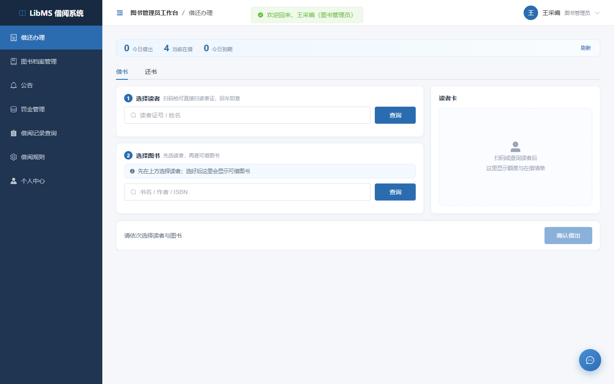

# LibMS 图书借阅管理系统

> 基于 Spring Boot 3 + Vue 3 的 B/S 图书借阅管理系统，面向中小型图书馆，设**系统管理员 / 图书管理员 / 读者**三类角色。

覆盖图书档案、读者账号、借还办理、预约排队、逾期罚金、数据统计与运行时数据一致性巡检，形成从档案管理到借还闭环的完整业务链路。



## 功能特性

| 模块 | 主要内容 |
|---|---|
| 图书档案 | 分类 / 出版社 / 图书维护，封面上传，Excel 批量导入（模板下载 + 逐行错误明细），热门借阅排行 |
| 读者与账号 | 三角色权限，自助注册（按 IP 与全站双窗口限流），借阅额度（可借数 / 欠费阈值 / 证件有效期），冻结与重置密码 |
| 借还办理 | 借书、还书、续借；并发场景防超借（条件更新同时约束库存与读者额度），逾期罚金与赔偿 |
| 预约排队 | 无可借副本时排队，到书通知，待取 7 天由定时任务回收，库存变动自动顺延队列 |
| 站内通知与邮件 | 到书 / 到期 / 逾期 / 欠费 / 证件将到期提醒；通知表兼作邮件 outbox（认领式发送 + 指数退避重试） |
| 数据统计 | 借阅趋势、分类分布、热门排行，多 sheet Excel 报表导出 |
| 数据一致性巡检 | 10 条规则 / 14 项检查，运行时比对库存、在借数、预约与业务记录，定位到具体数据行；只检测与定位，不自动改数据 |
| 权限与审计 | 令牌拦截 + 角色注解（未标注默认拒绝），写操作日志与业务同事务，密码变更后旧令牌立即失效 |

## 技术栈

| 层 | 选型 |
|---|---|
| 后端 | Java 21 · Spring Boot 3.2.5 · MyBatis-Plus 3.5.5 · JWT(jjwt 0.12.5) · EasyExcel · Maven |
| 前端 | Vue 3.5 · Element Plus · Pinia · Vue Router 4 · ECharts · Vite 5 |
| 数据库 | MySQL 8.0（10 张表 / 19 个 CHECK 约束，含生成列唯一索引处理逻辑删除与唯一约束的冲突） |
| 部署 | Docker Compose（MySQL + 后端 + Nginx 前端，一条命令拉起） |

规模：15 个控制器 / 59 个接口 / 17 个前端页面。

## 快速开始

### 方式一：Docker 一键部署（最快）

```bash
cd deploy/docker
cp .env.example .env      # 填入 MYSQL_ROOT_PASSWORD / MYSQL_PASSWORD / JWT_SECRET
docker compose up -d --build
```

浏览器访问 http://localhost:8088 ，用演示账号 `admin / 123456` 登录。

> `JWT_SECRET` 至少 32 字节，留空时 compose 会直接报错退出（避免用公开占位值启动）。
> 端口由 `WEB_PORT` 控制；Windows 上若 8088 落在系统保留端口段导致绑不上，改成 9088 等未占用端口即可。

### 方式二：本地运行

前置：JDK 21、Maven、Node.js 18+、MySQL 8.0（三者在同一台机器时按下面顺序启动）。

**1) 导入数据库**（建库 + 10 张表 + 演示数据，脚本可重复执行）

```bash
mysql -u root -p --default-character-set=utf8mb4 < docs/04_数据库设计.sql
```

`--default-character-set=utf8mb4` 不能省，否则导入中文会报 `ERROR 1406: Data too long`。

**2) 启动后端**（端口 8080）

```bash
cd backend
mvn clean package -DskipTests
# Windows 用 set，macOS / Linux 用 export
set DB_USERNAME=root
set DB_PASSWORD=你的MySQL密码
set JWT_SECRET=一串至少32字节的随机字符
java -jar target/libms-backend-1.0.0.jar
```

**3) 启动前端**（端口 5173）

```bash
cd frontend
npm install
npm run dev
```

浏览器访问 http://localhost:5173 。

> 数据库口令与 JWT 密钥**只能**通过环境变量注入：`application.yml` 不提供默认值，缺失时后端启动即失败。这是刻意的 fail-fast，用来避免生产环境误用默认口令。

### 方式三：Windows 一键启动

双击根目录的 `一键启动.bat`，脚本会设置本地演示口令并依次拉起后端与前端。

## 目录结构

```
backend/    Spring Boot 后端（Java 21，Maven，controller/service/mapper/audit）
frontend/   Vue 3 前端（Vite，views 下 17 个页面）
docs/       数据库脚本、设计与联调文档、从零运行手册、界面截图
test/       自动化回归（Python 黑盒接口/边界/安全套件 + Playwright 浏览器套件）
deploy/     部署脚本、SQL 迁移与 Docker Compose
```

## 测试

自动化回归共 **19 个套件 / 585 项断言**（后端接口、边界、安全、并发、巡检、E2E 与浏览器端）。

```bash
python test/run_all.py --browser
```

判定标准是退出码为 0、通过数可解析且与注册的期望数一致；每轮报告写入 `test/artifacts/`。

> 测试会重建 `library_db`（清空后重新导入种子），不是隔离临时库。跑之前请备份非种子数据。

## 文档

- `docs/从零开始运行手册.md` —— 从安装 MySQL 到浏览器登录的完整步骤（0 基础可照抄）
- `docs/04_数据库设计.sql` —— 建库建表脚本 + 种子数据，含 CHECK 约束与生成列唯一索引
- `docs/07_前后端联调说明.md` —— 接口约定与联调说明
- `deploy/docker/README.md` —— 容器部署、端口排查与数据卷说明

## 说明

- 演示账号 `admin / 123456` 来自种子数据，正式使用前请修改。
- 接口文档（Knife4j）默认关闭，需要时显式设置 `APP_API_DOCS_ENABLED=true`。
- 邮件通道默认关闭（`MAIL_ENABLED=false`），关闭时站内通知照常工作。
